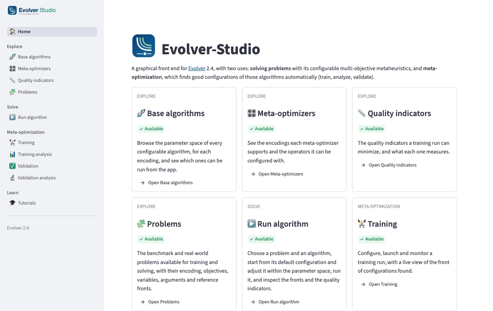
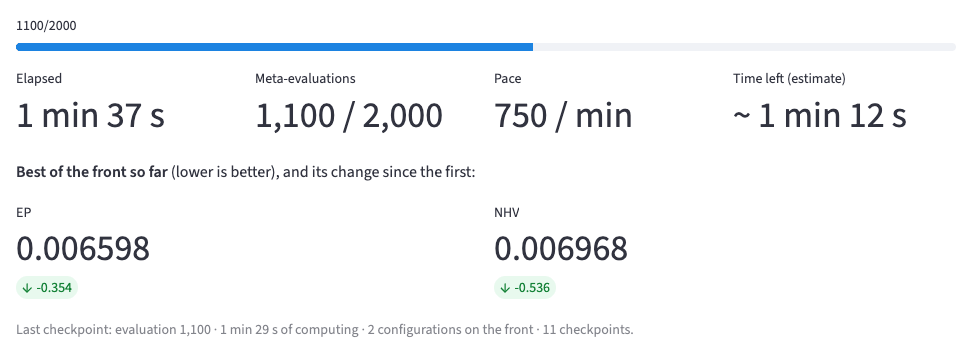
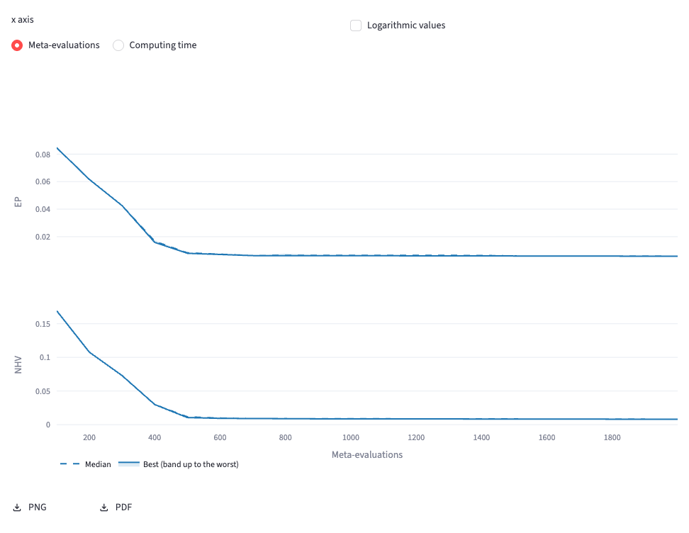
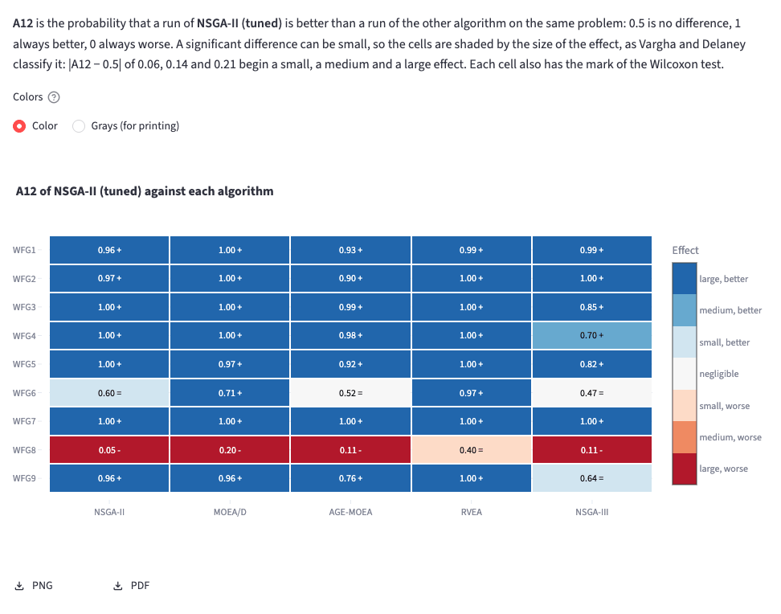
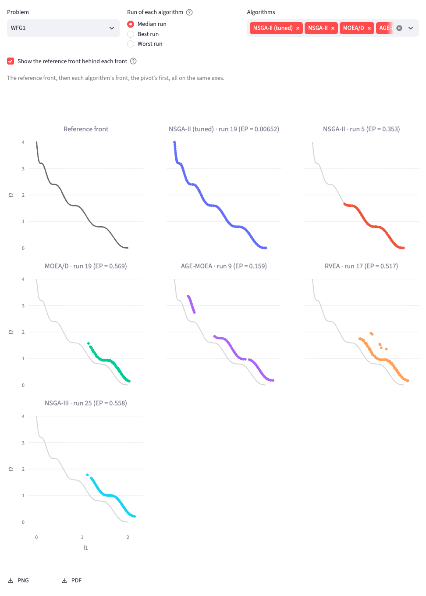

<p align="center">
  
</p>

<p align="center">
  <a href="LICENSE"></a>
  
  <a href="https://github.com/jMetal/Evolver"></a>
  
  <a href="https://streamlit.io/"></a>
</p>

# Evolver-Studio

**A graphical workbench for [Evolver](https://github.com/jMetal/Evolver)**, the Java framework for
the automated design of multi-objective metaheuristics. With Evolver-Studio you configure and run
Evolver's algorithms, let Evolver find good configurations of them (*meta-optimization*), and
analyze the results with the statistics a paper needs — without writing Java or editing YAML.

<p align="center">
  
</p>

## Why Evolver-Studio

- **No Java, no YAML.** Choose an algorithm, a problem and a configuration in forms; the app
  writes Evolver's request files, runs Evolver and reads its results.
- **Two uses in one tool.** *Solving*: run Evolver's configurable algorithms on a problem, as with
  jMetal's runners. *Meta-optimization*: train, analyze, validate.
- **Made for jobs that last hours.** Trainings and validation studies run in the background; close
  the browser and come back later. A live monitor shows progress, pace, time left, the front and
  the meta-optimizer's population as it evolves.
- **Statistics ready for a paper.** Wilcoxon tests with Holm or Benjamini-Hochberg corrections,
  Vargha-Delaney A12 effect sizes, Friedman, aligned Friedman and Quade tests with Demšar's
  critical difference plots, a Bayesian signed-rank test, attainment surfaces and EAF differences;
  tables in LaTeX, every chart in PNG or PDF, and the files [SAES](https://github.com/jMetal/SAES)
  reads.
- **Learn by doing.** Eight interactive tutorials, each paired with a tutorial of Evolver's
  documentation, run real examples inside the app.
- **In step with Evolver.** Parameter spaces, problems and indicators are read from Evolver's own
  release jar, and tests check the app against every new release.

## Gallery

| | |
|:---:|:---:|
|  |  |
| **Training** — a training run, followed live | **Training analysis** — how its meta-objectives converged |
|  |  |
| **Validation analysis** — effect sizes, shaded by their magnitude | **Validation analysis** — the median front of each algorithm |

## The workflow

**Solving a problem**: pick a problem in *Explore › Problems*, then configure and run an algorithm
on it in *Run algorithm*, and inspect its fronts, solutions and quality indicators.

**Meta-optimization** has four steps, a page each:

1. **Training** — choose the algorithm to configure, the problems to tune it for, the
   meta-objectives (quality indicators) and the meta-optimizer, and launch it.
2. **Training analysis** — read what it found: convergence, the front of configurations, what
   they have in common and how they differ from the default configuration.
3. **Validation** — run a configuration it found many times, next to the default configurations
   of other algorithms, on problems it was tuned for and on others.
4. **Validation analysis** — decide whether to trust it: where it wins, by how much, how it ranks
   over all the problems, what its fronts look like, and what it costs.

A configuration goes from one step to the next with a button, and from a training to *Run
algorithm*, to be used on a new problem.

## Pages

| Section | Page | What it does |
|---|---|---|
| Explore | Base algorithms | Browse the parameter space of every configurable algorithm, per encoding |
| Explore | Meta-optimizers | The meta-optimizers, their encodings (flat, tree) and their operators |
| Explore | Quality indicators | The indicators, what each one measures, and which way is better |
| Explore | Problems | Every problem: encoding, objectives, variables, arguments, reference fronts |
| Solve | Run algorithm | Run an algorithm from its default configuration, adjusted as you like; fronts, indicators, `VAR`/`FUN` |
| Meta-optimization | Training | Configure, launch, monitor and cancel a training run |
| Meta-optimization | Training analysis | Convergence, fronts, population and configurations of a finished training |
| Meta-optimization | Validation | Design a validation study, run it in the background and follow it |
| Meta-optimization | Validation analysis | Verdicts, Wilcoxon table, effect sizes, rankings, Bayesian test, fronts, attainment, cost |
| Learn | Tutorials | Interactive tutorials, paired with Evolver's documentation |

## Tutorials

| | Tutorial | Track | Pairs with |
|---|---|---|---|
| S1 | A tour of Evolver-Studio | Both | E4 |
| S2 | Exploring a parameter space | Both | E1 |
| S3 | Solving a problem with a configurable algorithm | Solving | E2 |
| S4 | Your first guided training | Meta-optimization | E3 |
| S5 | Customizing a training run | Meta-optimization | E5, E6, E10 |
| S6 | Analyzing training results | Meta-optimization | E7 |
| S7 | Validating a configuration | Meta-optimization | E8 |
| S8 | Analyzing a validation | Meta-optimization | E8 |

E1, E2… are the [tutorials of Evolver's documentation](https://github.com/jMetal/Evolver/blob/develop/docs/tutorials/index.rst),
which cover the same ground with Java code. More tutorials are planned (comparing configurations,
using a tuned configuration, your own problem, meta-optimizers and encodings, long-running jobs).

## Supported algorithms

Evolver-Studio browses the parameter space of every configurable algorithm in Evolver. Those that
can be run from the app:

| Level | Algorithms |
|---|---|
| Base level | NSGA-II, MOEA/D, SMS-EMOA, PAES (Double, Binary, Permutation); RDE-MOEA (Double, Permutation); NSGA-III, AGE-MOEA, RVEA, SSMOEA (Double) |
| Meta level | NSGA-II, AGE-MOEA, SPEA2, SMPSO, Async NSGA-II, Random Search (flat encoding); NSGA-II, AGE-MOEA, Async NSGA-II, Random Search (tree encoding) |

MOPSO is browsable only, until Evolver's command-line runner supports it. See Evolver's
[supported algorithms](https://github.com/jMetal/Evolver#supported-algorithms) for the full list.

## Requirements

- Python 3.11 or newer and [Conda](https://docs.conda.io/)
- Java 21 or newer, on the `PATH`
- Optionally, Google Chrome or Chromium, to save the charts as PNG or PDF

No Evolver checkout and no Maven: the app downloads the jar of **Evolver 2.4** from Maven Central
the first time. Evolver-Studio has its own version numbers and works with one Evolver release at a
time:

| Evolver-Studio | Evolver |
|---|---|
| 1.0.0 (in preparation) | 2.4 |

## Installation

```bash
git clone https://github.com/jMetal/Evolver-Studio.git
cd Evolver-Studio
make env   # creates (or updates) the 'evolver-studio' Conda environment
```

## Quick start

```bash
make run   # opens Evolver-Studio in your browser
```

1. The first time, click **Download Evolver 2.4** in the sidebar (about 130 MB, checksum verified).
2. Open **Tutorials** and start with **S1. A tour of Evolver-Studio**.
3. To solve a problem right away, open **Run algorithm**, choose a problem (ZDT1, for instance),
   keep NSGA-II with its default configuration and click **Run**.
4. To train, open **Training**, keep the defaults (NSGA-II tuned for ZDT4, about three minutes) and
   click **Launch training**; when it ends, open **Training analysis**.

## How it works

Evolver-Studio runs Evolver's release jar as a separate process and talks to it through files, not
a server:

```text
Evolver-Studio (Streamlit)
  ├─> DescribeMain            what Evolver can run: algorithms, problems, indicators
  ├─> SolveRunnerMain         a run of an algorithm (Run algorithm, each job of a validation study)
  └─> TrainingRunnerMain      a training run
        request.yaml  ──>  Evolver  ──>  status.yaml (progress) and the results:
                                          INDICATORS.csv, VAR_CONF.txt, FUN.csv, VAR.csv, ...
```

Long jobs run as detached processes: closing or reloading the browser does not stop them, and
reopening the app reconnects to them. Parameter spaces are read from the jar, and the reference
fronts and weight vectors the runs need are copied from Evolver into
[`resources/`](resources/README.md).

### Where your data lives

Everything is kept in plain files next to the app, so that it survives restarts and can be read
with any tool:

| Folder | Contents |
|---|---|
| `cli-runner-runs/` | One folder per training: its request, status and log |
| `results/` | What Evolver wrote for each training (`INDICATORS.csv`, `VAR_CONF.txt`, `METADATA.txt`…) |
| `solve-runs/` | The runs of *Run algorithm* |
| `validation-runs/` | The validation studies, with every run's front and indicators |

## Troubleshooting

- **"Java was not found on the PATH"**: install Java 21 or newer (for example
  [Temurin](https://adoptium.net/)) and restart the app.
- **The jar does not download**: check the connection to Maven Central, or download
  `Evolver-2.4-jar-with-dependencies.jar` by hand into `lib/`.
- **No PNG/PDF buttons under the charts**: they need Chrome or Chromium; the camera icon of each
  chart still saves it as PNG.
- **Port 8501 in use**: `streamlit run app.py --server.port 8502`.

## Development

```bash
make lint     # ruff check .
make format   # ruff format .
make test     # pytest tests/ -x
```

To run the app against another Evolver build, such as one of Evolver's `develop` branch, point the
`EVOLVER_JAR` environment variable at its jar:

```bash
EVOLVER_JAR=/path/to/Evolver-3.0-SNAPSHOT-jar-with-dependencies.jar make run
```

Tests that need Evolver's jar are skipped without it. `tests/test_catalogue.py` keeps the app's
catalogue of algorithms (`evolver_studio/catalogue.py`) in sync with Evolver: it fails on any
parameter space of the jar the catalogue does not account for, and checks the catalogue against
the manifest Evolver's `DescribeMain` prints. Moving to a new Evolver release means changing
`EVOLVER_VERSION` in `evolver_studio/evolver_client.py` and running `make sync-resources`.
`python scripts/screenshots.py` retakes the images of this README from a running app.

Code and commits follow [CODING_GUIDELINES.md](CODING_GUIDELINES.md) and
[GIT_GUIDELINES.md](GIT_GUIDELINES.md); changes are listed in [CHANGELOG.md](CHANGELOG.md).

## Roadmap

Evolver-Studio 1.0 will be released with Evolver 3.0. After it: the tutorials still planned, a
Docker image, and comparisons of several trainings. See [ROADMAP.md](ROADMAP.md).

## Citation

Evolver-Studio has no publication of its own yet. If you use it in your research, please cite
Evolver:

```bibtex
@article{AND23,
  title   = {Evolver: Meta-optimizing multi-objective metaheuristics},
  journal = {SoftwareX},
  volume  = {23},
  pages   = {101551},
  year    = {2024},
  issn    = {2352-7110},
  doi     = {10.1016/j.softx.2023.101551},
}
```

## License

Evolver-Studio is licensed under the GNU General Public License v3.0 — see [LICENSE](LICENSE).
